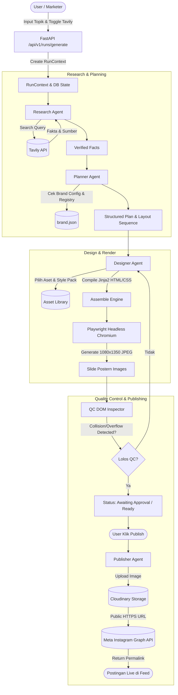
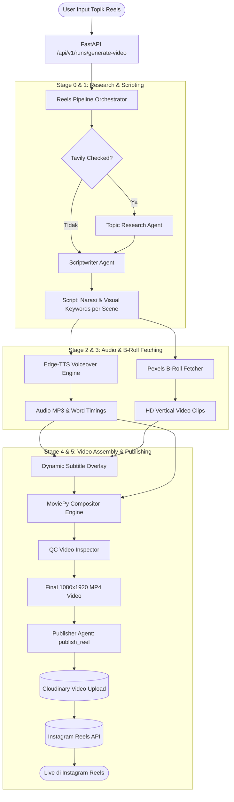

# Dokumentasi Arsitektur Sistem AI Agent (GTNIC 2026)

> **Enterprise Social Media Autonomous Content Engine (Carousel & Reels)**  
> Dokumentasi teknis komprehensif mengenai arsitektur, workflow multi-agent, peralatan (tools), struktur repositori, skema database, observabilitas biaya, dan panduan integrasi API.

---

## Daftar Isi
1. [Ringkasan Eksekutif & Value Proposition](#1-ringkasan-eksekutif--value-proposition)
2. [Tech Stack & Komponen Utama](#2-tech-stack--komponen-utama)
3. [Arsitektur & Struktur Folder Proyek](#3-arsitektur--struktur-folder-proyek)
4. [Daftar Agen Mandiri (Autonomous Agents)](#4-daftar-agen-mandiri-autonomous-agents)
5. [Daftar Tools & Eksekutor Tindakan](#5-daftar-tools--eksekutor-tindakan)
6. [Workflow End-to-End](#6-workflow-end-to-end)
   - [Pipeline 1: Instagram Carousel](#pipeline-1-instagram-carousel-autonomous-flow)
   - [Pipeline 2: Vertical Video Reels](#pipeline-2-vertical-video-reels-autonomous-flow)
7. [Observabilitas, Audit Event, dan Cost Accounting](#7-observabilitas-audit-event-dan-cost-accounting)
8. [Database Schema (SQLAlchemy & SQLite)](#8-database-schema-sqlalchemy--sqlite)
9. [Konfigurasi Environment Variable & API Keys](#9-konfigurasi-environment-variable--api-keys)
10. [Panduan Menjalankan Sistem (How to Run)](#10-panduan-menjalankan-sistem-how-to-run)

---

## 1. Ringkasan Eksekutif & Value Proposition

Sistem ini dirancang khusus untuk memecahkan kelemahan umum AI dalam pembuatan konten korporat (*AI slop*, teks berhalusinasi, layout tumpang tindih, dan postingan tidak bermerek). 

### Nilai Utama:
- **No-AI-Slop Visual Pipeline**: Desain visual tidak dihasilkan melalui generator gambar bitmap yang sering membuat teks tipografi rusak. Desain dirender berbasis **HTML5/CSS modern terstruktur** menggunakan headless browser Playwright, dilengkapi *automatic DOM collision detector* dan *font autoscaling*.
- **Autonomous Multi-Agent Collaboration**: Setiap agen memiliki tanggung jawab terisolasi (Riset Fakta, Perencanaan Konsep, Desain Visual, Pengecekan Kualitas QC, Pembuatan Skrip, Sintesis Suara, Pengambilan B-Roll, hingga Publikasi).
- **Dual Format Support**: Menghasilkan konten **Carousel Instagram (1080x1350, 4:5)** dan **Video Reels / Shorts (1080x1920, 9:16)** dari satu topik input.
- **Enterprise Guardrails & Human-in-the-Loop**: Dilengkapi gerbang persetujuan aset figur/talent (Cloudflare Flux AI + Rembg) dan verifikasi kuota sebelum API Meta dieksekusi.
- **Transparansi Biaya & Audit Trail Penuh**: Setiap token LLM, panggilan HTTP, waktu eksekusi, dan estimasi biaya USD dicatat real-time ke database dan ditampilkan di terminal drawer.

---

## 2. Tech Stack & Komponen Utama

### Backend (Python 3.11 - 3.14)
- **FastAPI & Uvicorn**: REST API asynchronous berperforma tinggi dengan background worker tasks.
- **Groq API (`groq==1.7.0`)**: Mesin inferensi LLM ultra-cepat (default: `openai/gpt-oss-120b` dengan fallback).
- **Tavily Search API (`tavily-python==0.8.5`)**: Mesin pencari web real-time yang dioptimalkan untuk sintesis fakta AI tanpa noise scraping.
- **Playwright (`playwright==1.56.0`)**: Headless Chromium untuk merender layout HTML/CSS menjadi gambar JPEG poster resolusi tinggi (1080x1350) dengan presisi pixel.
- **Jinja2 (`jinja2==3.1.6`)**: Mesin templating layout dinamis untuk injeksi data, warna merek, dan token desain.
- **Edge-TTS (`edge-tts>=7.0.0`)**: Generator teks-ke-suara (Text-to-Speech) dengan pelacakan metadata *word-level timing* untuk auto-subtitle kinetik.
- **MoviePy & ImageIO (`moviepy>=2.2.0`, `imageio[ffmpeg]`)**: Compositing video multi-track, cropping 9:16 vertikal, mixing background music (BGM), dan perakitan klip B-roll.
- **Pillow & Rembg (`Pillow==12.3.0`, `rembg[cpu]==2.0.85`)**: Pengolahan citra digital, manipulasi raster, dan pemotongan latar belakang (background removal) otomatis menggunakan model ONNX CPU.
- **Cloudinary (`cloudinary==1.46.3`)**: Cloud media storage untuk hosting aset gambar dan video ber-URL publik HTTPS yang disyaratkan oleh Meta Graph API.
- **Meta Instagram Graph API**: Publikasi otomatis media carousel dan video Reels ke feed bisnis/creator.
- **SQLAlchemy (`SQLAlchemy==2.0.55`) & Alembic**: ORM modern untuk manajemen state, event logs, dan persistensi data run.
- **Pydantic (`pydantic==2.14.1`)**: Validasi skema input/output ketat di seluruh agen dan endpoint.

### Frontend
- **React 19 (`react==^19.3.1`) & Vite**: Single Page Application (SPA) reaktif dan modern.
- **Tailwind CSS & Lucide React**: Dashboard dark-mode berstandar enterprise dengan visualizer live streaming logs.

---

## 3. Arsitektur & Struktur Folder Proyek

Repositori disusun modular dengan pemisahan tegas antara pipeline **Carousel** dan pipeline **Reels**:

```text
step1/
├── backend/
│   ├── config/
│   │   └── brand.json              # Konfigurasi identitas korporat (warna, font, handle, aturan)
│   ├── data/
│   │   └── app.db                  # Database lokal SQLite (runs, events, assets, credentials)
│   ├── output/                     # Output hasil render lokal (posters, reels, temp audio)
│   ├── src/
│   │   ├── api.py                  # Router FastAPI & orchestrator background task
│   │   ├── config.py               # Loader env & helper paths
│   │   ├── core/                   # Modul pondasi bersama (Shared Core)
│   │   │   ├── context.py          # RunContext: state sharing, audit emitter, token tracker
│   │   │   ├── credentials.py      # Manajemen & verifikasi token Instagram OAuth
│   │   │   ├── db.py               # Model SQLAlchemy (Run, Plan, Design, Event, Asset, Pub)
│   │   │   ├── events.py           # Engine event emitter (DB logging + stdout)
│   │   │   ├── http.py             # Wrapper HttpClient dengan auto-redaction token & timeout
│   │   │   ├── keys.py             # Rotasi key API otomatis bila kuota habis
│   │   │   ├── llm.py              # Wrapper Groq LLM dengan auto-retry, tracking biaya, & fallback
│   │   │   └── pricing.py          # Tabel kalkulasi harga token per model LLM
│   │   ├── carousel/               # DOMAIN CAROUSEL INSTAGRAM
│   │   │   ├── agents/
│   │   │   │   ├── research_agent.py   # Agent 1: Riset tren & data fakta via Tavily + LLM
│   │   │   │   ├── facts.py            # Parser & validator fakta JSON
│   │   │   │   ├── planner.py          # Agent 2: Konseptor alur carousel & layout selector
│   │   │   │   ├── designer.py         # Agent 3: Assembling HTML/CSS & pemanggilan Playwright
│   │   │   │   └── publisher.py        # Agent 5: Preflight validation & publikasi ke Meta API
│   │   │   ├── tools/
│   │   │   │   ├── search.py           # Adapter pemanggilan Tavily Search
│   │   │   │   ├── qc.py               # Guardrail aturan teks & slide structure
│   │   │   │   ├── qc_dom.py           # Agent 4 (QC): Pemeriksaan collision & overflow DOM
│   │   │   │   ├── asset_library.py    # Manajemen aset lokal & database figur/talent
│   │   │   │   ├── cloudflare_pose_generator.py # Tool generate variasi pose via Workers AI
│   │   │   │   ├── compositor.py       # Manipulasi image Pillow & shadow composer
│   │   │   │   ├── hosting.py          # Uploader poster JPEG & video MP4 ke Cloudinary
│   │   │   │   ├── instagram.py        # Meta Graph API SDK (Carousel, Image, Reels)
│   │   │   │   └── pexels_client.py    # Client pencarian video stok B-Roll
│   │   │   ├── layouts/            # Pustaka Template Layout (HTML, CSS, JSON Schema)
│   │   │   │   ├── registry.py     # Registry & validasi schema layout
│   │   │   │   ├── models.py       # Pydantic data model layout
│   │   │   │   ├── cover_*/        # Varian layout cover (judul raksasa, echo blur, dialog meme, dll)
│   │   │   │   ├── penjelasan_*/   # Varian layout isi (split foto, teks ikon, tipografi)
│   │   │   │   ├── perbandingan_*/ # Varian perbandingan (mitos vs fakta, dua kolom)
│   │   │   │   ├── data_*/         # Varian visualisasi data statistik
│   │   │   │   └── cta_*/          # Varian slide ajakan bertindak / penutup
│   │   │   ├── render/
│   │   │   │   ├── assemble.py     # Compiler template Jinja2, style tokens, & asset base64
│   │   │   │   ├── renderer.py     # Headless Chromium Playwright render engine
│   │   │   │   ├── autofit.js      # Script browser untuk auto-shrink ukuran teks bila overflow
│   │   │   │   └── base.css        # CSS reset, typography base, & grid canvas
│   │   │   └── pipeline.py         # Orchestrator sinkron/asinkron alur Carousel
│   │   └── reels/                  # DOMAIN SHORT-FORM VERTICAL VIDEO
│   │       ├── agents/
│   │       │   ├── topic_research.py   # Riset fakta topik video via Tavily
│   │       │   └── scriptwriter.py     # Penulis naskah narasi per-scene & kata kunci visual
│   │       ├── tools/
│   │       │   ├── tts_engine.py       # Sintesis Edge-TTS + word timestamping
│   │       │   ├── broll_fetcher.py    # Pexels video fetcher dengan auto-caching
│   │       │   ├── subtitle_builder.py # Pembuat overlay teks kinetik berbasis Pillow
│   │       │   ├── compositor.py       # MoviePy video stitching, audio sync, & BGM loop
│   │       │   ├── bgm.py              # Generator background music synthesizer fallback
│   │       │   └── qc_video.py         # Guardrail video (resolusi 1080x1920, durasi, audio)
│   │       ├── models.py           # Schema Pydantic VideoScript, SceneSpec, WordTiming
│   │       └── pipeline.py         # Orchestrator 5-stage pipeline video Reels
│   ├── scripts/                    # CLI utility tools (add_asset, approve_asset, render_gallery)
│   └── tests/                      # Test suite pytest komprehensif
├── frontend/
│   ├── src/
│   │   ├── api.js                  # HTTP client ke FastAPI backend
│   │   ├── App.jsx                 # Dashboard utama, live preview, terminal drawer, brand editor
│   │   └── App.css                 # Styling dashboard
│   └── package.json
└── dump/                           # Folder arsip dokumen draft, proposal, & diff lama (.gitignored)
```

---

## 4. Daftar Agen Mandiri (Autonomous Agents)

### A. Agen Carousel
1. **Research Agent (`carousel/agents/research_agent.py`)**
   - **Tugas**: Menerima topik dari user, menjalankan riset web melalui Tavily API untuk mencari fakta terkini, tren, dan statistik industri.
   - **Output**: JSON ringkasan riset terstruktur, daftar sumber URL, dan kumpulan fakta terverifikasi (`facts.py`).
2. **Planner Agent (`carousel/agents/planner.py`)**
   - **Tugas**: Bertindak sebagai Creative Director. Membaca fakta riset dan konfigurasi `brand.json`, menyusun narasi slide demi slide (Hook -> Story -> Insight -> Action), memilih layout yang paling pas dari registry layout, serta menulis caption Instagram lengkap dengan hashtag.
   - **Output**: Objek rencana konten (`Plan`) yang memenuhi variasi ritme desain.
3. **Designer Agent (`carousel/agents/designer.py`)**
   - **Tugas**: Memetakan rencana konten ke template HTML/CSS Jinja2, memilih style pack warna merek, mencocokkan pose figur talent dari `asset_library`, dan mengompilasi kode dokumen visual.
4. **QC DOM Inspector Agent (`carousel/tools/qc_dom.py`)**
   - **Tugas**: Mengevaluasi hasil render Playwright di level DOM. Mendeteksi jika ada teks yang bertumpuk (bounding box collision), font yang meluap dari batas kanvas (overflow), atau kontras warna yang tidak terbaca. Bila gagal, agen meminta desainer melakukan auto-reflow atau revisi layout.
5. **Publisher Agent (`carousel/agents/publisher.py`)**
   - **Tugas**: Menjalankan *Preflight check* (validasi integritas file JPEG, rasio aspek, kuota API Instagram), mengunggah gambar ke Cloudinary CDN, membuat container Carousel di Meta Graph API, dan mempublikasikan postingan secara live.

### B. Agen Video Reels
1. **Topic Research Agent (`reels/agents/topic_research.py`)**
   - **Tugas**: Melakukan ekstraksi fakta spesifik topik dari internet via Tavily agar naskah video akurat dan tidak berisi halusinasi.
2. **Scriptwriter Agent (`reels/agents/scriptwriter.py`)**
   - **Tugas**: Menyusun naskah video vertikal 9:16 berdurasi 15–60 detik. Membagi naskah menjadi beberapa *scene*, menulis teks voiceover yang natural, dan menentukan kata kunci pencarian footage B-roll per scene.
3. **QC Video Inspector (`reels/tools/qc_video.py`)**
   - **Tugas**: Memeriksa file video akhir: memastikan resolusi tepat 1080x1920 (9:16), frame rate stabil, track audio tidak hening, file size dalam batas wajar, dan durasi sesuai target.

---

## 5. Daftar Tools & Eksekutor Tindakan

| Tool / Modul | Lokasi File | Fungsi & Peran |
|---|---|---|
| **Tavily Search Tool** | `carousel/tools/search.py` | Mengambil data web real-time berbobot tinggi tanpa markup HTML kotor. |
| **Playwright Renderer** | `carousel/render/renderer.py` | Merender HTML menjadi JPEG 1080x1350 kualitas 92% menggunakan engine Chromium headless. |
| **Template Assembler** | `carousel/render/assemble.py` | Menggabungkan template HTML Jinja2, style pack, base64 aset figur, dan script autofit. |
| **Asset Library** | `carousel/tools/asset_library.py` | Mengelola repositori figur talent (status approved, pending_review, rejected). |
| **Cloudflare Pose Gen** | `carousel/tools/cloudflare_pose_generator.py` | Menghasilkan pose baru talent korporat secara AI-in-the-loop menggunakan model Flux. |
| **Compositor Pillow** | `carousel/tools/compositor.py` | Memotong background talent (`rembg`), memberi drop-shadow halus, dan menyisipkan logo. |
| **Cloudinary Uploader** | `carousel/tools/hosting.py` | Mengunggah poster gambar dan video MP4 ke CDN Cloudinary dengan public URL HTTPS. |
| **Instagram API Client** | `carousel/tools/instagram.py` | Integrasi langsung dengan Meta Graph API (Single Media, Carousel Container, Reels). |
| **Pexels Client** | `carousel/tools/pexels_client.py` | Mencari dan mengunduh video klip stok vertikal bebas royalti sesuai kata kunci scene. |
| **TTS Engine** | `reels/tools/tts_engine.py` | Menghasilkan audio MP3 suara manusia (Edge-TTS) beserta offset waktu per kata (*word timing*). |
| **Subtitle Builder** | `reels/tools/subtitle_builder.py` | Merender teks animasi kinetik (kata aktif di-highlight dengan latar kontras) di kanvas video. |
| **Video Compositor** | `reels/tools/compositor.py` | Menggabungkan klip B-roll, voiceover, background music, dan subtitle menjadi file final MP4. |

---

## 6. Workflow End-to-End

### Pipeline 1: Instagram Carousel (Autonomous Flow)



### Pipeline 2: Vertical Video Reels (Autonomous Flow)



---

## 7. Observabilitas, Audit Event, dan Cost Accounting

Sistem menyertakan subsistem akuntansi biaya LLM dan pelacakan audit secara *real-time*:

1. **`RunContext` (`core/context.py`)**:
   - Berfungsi sebagai dependency injection container yang dibawa melintasi seluruh tahapan agen.
   - Menyimpan instance `HttpClient`, `LLMClient`, `EventCollector`, dan sesi SQLAlchemy.
2. **Kalkulasi Biaya Terperinci (`core/pricing.py`)**:
   - Menghitung biaya token input dan token output berdasarkan model yang digunakan (Groq Llama 3, GPT-OSS, dll).
   - Menghitung unit penggunaan pihak ketiga (Tavily search units, Cloudinary bandwidth, Cloudflare compute).
3. **Audit Event Log (`core/events.py` & tabel `events`)**:
   - Setiap aksi agen mencatat: `step`, `kind` (`llm_call`, `tool_call`, `render`, `publish`), `tokens_in`, `tokens_out`, `duration_ms`, dan `status`.
   - Log ini di-stream secara berkala ke antarmuka terminal visual di Frontend.

---

## 8. Database Schema (SQLAlchemy & SQLite)

Database disimpan secara persisten di `backend/data/app.db`:

- **`runs`**: Menyimpan siklus hidup eksekusi konten (`id`, `topic`, `status`, `tokens_in`, `tokens_out`, `cost_usd`, `started_at`, `finished_at`).
- **`research_snapshots`**: Menyimpan hasil scraping dan sintesis fakta Tavily JSON untuk keperluan caching dan audit referensi.
- **`plans`**: Menyimpan draf konten multi-slide (konsep, caption, layout per slide, hook, CTA).
- **`designs`**: Menyimpan manifest visual hasil render (path file JPEG/MP4, preview thumbnail, status QC).
- **`assets`**: Katalog gambar figur/talent perusahaan lengkap dengan status approval (`approved`, `pending_review`, `rejected`) dan embedding model generator.
- **`events`**: Audit trail lengkap setiap tool execution, token usage, error stacktrace, dan durasi milidetik.
- **`publications`**: Catatan status pengiriman ke Instagram (status `intent` sebelum call API, dan `published` dengan `media_id` serta `permalink`).
- **`credentials_status`**: Monitor masa berlaku access token Instagram untuk pencegahan failure di level enterprise.

---

## 9. Konfigurasi Environment Variable & API Keys

Buat file `backend/.env` (bisa diduplikasi dari `.env.example`):

```bash
# --- LLM ENGINE (GROQ) ---
GROQ_API_KEY=gsk_your_groq_api_key_here
GROQ_MODEL=openai/gpt-oss-120b

# --- SEARCH ENGINE (TAVILY) ---
TAVILY_API_KEY=tvly-your_tavily_key_here

# --- B-ROLL STOCK VIDEO (PEXELS) ---
PEXELS_API_KEY=your_pexels_api_key_here

# --- PUBLIC MEDIA HOSTING (CLOUDINARY) ---
CLOUDINARY_CLOUD_NAME=your_cloudinary_name
CLOUDINARY_API_KEY=your_cloudinary_api_key
CLOUDINARY_API_SECRET=your_cloudinary_api_secret

# --- INSTAGRAM GRAPH API ---
IG_USER_ID=your_instagram_business_account_id
IG_TOKEN=your_meta_system_user_or_long_lived_token
IG_API_BASE=https://graph.instagram.com

# --- CLOUDFLARE WORKERS AI (OPSIONAL: TALENT POSE GENERATOR) ---
CLOUDFLARE_ACCOUNT_ID=your_account_id
CLOUDFLARE_API_TOKEN=your_token
CLOUDFLARE_IMAGE_MODEL=@cf/black-forest-labs/flux-2-klein-9b
CLOUDFLARE_POSE_GENERATION=false
```

---

## 10. Panduan Menjalankan Sistem (How to Run)

### 1. Prasyarat Sistem
- Python 3.11 atau 3.12 (disarankan menggunakan virtualenv).
- Node.js >= 18 dan npm.
- Headless browser Chromium untuk Playwright.

### 2. Instalasi Backend
```bash
cd backend

# Aktifkan virtual environment kamu
source /path/to/venv/bin/activate

# Install dependensi backend
pip install -r requirements.txt

# Install browser binary untuk Playwright
playwright install chromium

# Jalankan backend API server
PYTHONPATH=. uvicorn src.api:app --reload --port 8000
```

### 3. Instalasi Frontend
```bash
cd frontend

# Install package npm
npm install

# Jalankan frontend development server
npm run dev
```

Buka browser di `http://localhost:5173` untuk mengakses dashboard kontrol AI Agent.
Pilih tab **Carousel (IG)** atau **Video Reels**, centang **Live Tavily Search**, masukkan topik bisnis korporat, lalu klik **"Jalankan Autonomous Pipeline"**.
Konten yang dihasilkan dapat langsung di-publish ke Instagram feed atau reels melalui tombol terintegrasi di antarmuka.
