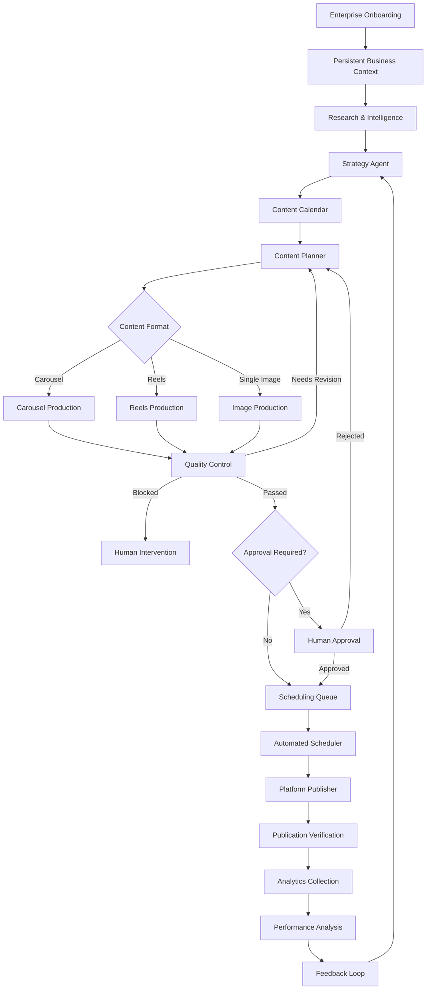

# SOCIALFLOW AI — Final Product Specification

> Autonomous AI Agent for Enterprise Social Media Operations

## 1. Product Overview

### 1.1 Vision

SOCIALFLOW AI adalah autonomous AI agent yang membantu perusahaan mengelola keseluruhan operasional media sosial secara otomatis, mulai dari memahami bisnis, menyusun strategi, melakukan riset, membuat konten, menjadwalkan publikasi, memublikasikan konten, menganalisis performa, hingga meningkatkan strategi berdasarkan hasil sebelumnya.

SOCIALFLOW AI bukan sekadar AI content generator atau chatbot yang menghasilkan caption.

Sistem harus mampu mengambil keputusan berdasarkan konteks perusahaan, tujuan bisnis, tren terkini, performa konten sebelumnya, serta aturan brand yang telah ditentukan.

### 1.2 Core Objectives

1. Mengurangi pekerjaan manual dalam operasional media sosial perusahaan.
2. Menghasilkan strategi konten yang relevan dengan tujuan bisnis.
3. Mengotomatisasi proses riset, perencanaan, produksi, quality control, dan publikasi konten.
4. Memastikan konten tetap konsisten dengan identitas dan aturan perusahaan.
5. Menggunakan analytics untuk mengevaluasi dan meningkatkan strategi berikutnya.
6. Menyediakan sistem yang dapat berjalan secara berkelanjutan tanpa harus menunggu instruksi pengguna setiap saat.

### 1.3 Target Users

- UMKM yang ingin mengelola media sosial secara konsisten.
- Perusahaan yang memiliki beberapa produk atau layanan.
- Marketing team.
- Social media manager.
- Digital marketing agency.
- Enterprise yang membutuhkan otomatisasi operasional media sosial.

---

# 2. Product Capabilities

SOCIALFLOW AI harus memiliki delapan kapabilitas utama:

1. Enterprise Onboarding & Business Context
2. Research & Intelligence
3. Strategy & Content Planning
4. Automated Content Production
5. Quality Control & Brand Compliance
6. Scheduling & Publishing
7. Analytics & Performance Monitoring
8. Feedback Loop & Continuous Optimization

Semua kapabilitas tersebut harus saling terhubung, bukan berjalan sebagai fitur yang terpisah.

---

# 3. Enterprise Onboarding & Business Context

## 3.1 Purpose

Sistem harus memahami perusahaan sebelum mulai membuat strategi atau konten.

Pengguna tidak perlu menjelaskan ulang identitas perusahaan setiap kali menjalankan campaign.

Seluruh informasi perusahaan disimpan sebagai persistent business context yang dapat digunakan oleh semua agent.

## 3.2 Enterprise Profile

Pengguna dapat memasukkan:

### Business Information
- Company name.
- Business description.
- Industry.
- Products and services.
- Target audience.
- Business location (optional).
- Website.
- Main business objectives.

### Brand Identity
- Company logo.
- Primary and secondary colors.
- Brand typography.
- Visual identity.
- Brand personality.
- Tone of voice.
- Preferred content style.
- Reference designs.
- Existing marketing assets.

### Audience Information
- Target audience demographics, when available.
- Audience interests.
- Customer problems.
- Customer needs.
- Preferred communication style.
- Target market segments.

### Social Media Configuration
- Instagram account.
- Supported social media platforms.
- Account type.
- Connected publishing integrations.
- Available content formats.
- Publishing preferences.

### Operational Preferences
- Posting frequency.
- Preferred publishing days.
- Preferred publishing hours.
- Campaign objectives.
- Content categories.
- Approval workflow.
- Restricted topics.
- Content requirements.

### Optional Media Assets
- Employee photos.
- Product photos.
- Office photos.
- Brand ambassadors.
- Existing promotional materials.
- Product demonstrations.

## 3.3 Persistent Enterprise Context

The system must store all enterprise information in a database.

Every agent must be able to access the relevant enterprise context.

For example:

- Research Agent uses the industry, products, audience, and business objectives.
- Strategy Agent uses business objectives, audience, brand identity, and analytics.
- Designer Agent uses logo, colors, typography, and visual references.
- Copywriter Agent uses tone of voice, products, and audience.
- Publisher Agent uses platform configuration and publishing preferences.
- Analyst Agent uses business objectives and historical performance.

The system must support updating the enterprise profile without losing historical campaign data.

Each generated campaign should retain a reference to the enterprise profile version and strategy used at the time.

---

# 4. Research & Intelligence

## 4.1 Purpose

The system must continuously identify relevant opportunities for the company to publish content.

Research must not simply collect popular trends.

It must determine whether a trend or topic is relevant to the company's industry, audience, products, and objectives.

## 4.2 Research Capabilities

The Research Agent must be able to:

- Search recent news and industry developments.
- Discover relevant social media trends.
- Identify trending topics.
- Research competitors when appropriate.
- Identify customer interests and problems.
- Discover relevant educational topics.
- Find opportunities for promotional content.
- Retrieve supporting sources.
- Identify potentially misleading or outdated information.

## 4.3 Relevance Evaluation

Every research result should be evaluated using:

- Relevance to the company's industry.
- Relevance to products and services.
- Relevance to the target audience.
- Alignment with business objectives.
- Content potential.
- Timeliness.
- Source reliability.
- Brand safety.

The system should reject irrelevant trends even when they are popular.

## 4.4 Research Output

Each research result should contain:

- Topic.
- Description.
- Supporting sources.
- Publication date or source date when available.
- Relevance score.
- Reason for relevance.
- Potential audience.
- Suggested content angle.
- Recommended content format.
- Risk or verification notes.

The research results become input for the Strategy Agent.

---

# 5. Strategy & Content Planning

## 5.1 Purpose

The Strategy Agent is responsible for deciding what the company should publish, why it should publish it, when it should be published, and what outcome it expects.

The system must not generate random content without a clear strategic purpose.

## 5.2 Strategy Generation

The Strategy Agent considers:

- Enterprise profile.
- Business objectives.
- Target audience.
- Products and services.
- Research results.
- Current trends.
- Historical content performance.
- Previous campaigns.
- Available content assets.
- Publishing preferences.
- Budget or operational limitations, when provided.

## 5.3 Content Pillars

The system should identify and maintain content pillars based on the company's business.

Examples:

- Educational content.
- Product awareness.
- Promotional content.
- Industry insights.
- Customer stories.
- Behind-the-scenes content.
- Brand awareness.
- Community engagement.

The content pillars must be configurable and should not be identical for every company.

## 5.4 Content Format Decision

The system must autonomously determine the most appropriate format:

### Carousel
Suitable for:
- Educational explanations.
- Step-by-step guides.
- Lists and recommendations.
- Product comparisons.
- Informational content.

### Reels
Suitable for:
- Short demonstrations.
- Storytelling.
- Product showcases.
- Trend-based content.
- Short educational videos.
- Brand awareness.

### Single Image
Suitable for:
- Announcements.
- Promotional materials.
- Important updates.
- Simple visual messages.

The decision should consider the content objective, audience, available assets, platform characteristics, and production feasibility.

The system must explain why a format was selected.

## 5.5 Content Calendar

The Strategy Agent must generate a content calendar containing:

- Content title.
- Topic.
- Content pillar.
- Campaign.
- Business objective.
- Target audience.
- Content format.
- Suggested publishing date.
- Suggested publishing time.
- Caption direction.
- Call to action.
- Research references.
- Expected outcome.
- Production status.
- Approval status.

## 5.6 Campaign Management

Users should be able to create and manage campaigns.

Each campaign should contain:

- Campaign name.
- Objective.
- Target audience.
- Start and end dates.
- Products or services involved.
- Campaign message.
- Content requirements.
- Planned publications.
- Performance targets.

The system should coordinate multiple content pieces within the same campaign.

## 5.7 Strategy Revision

The system must be able to revise its strategy when:

- Business objectives change.
- New products are introduced.
- New trends become relevant.
- Previous content performs poorly.
- Analytics reveal new audience interests.
- Publishing schedules change.

Strategy generation must be dynamic and grounded in enterprise context, not merely static templates.

---

# 6. Automated Content Production

## 6.1 Purpose

Once the strategy and content plan are ready, the system should automatically produce the required content.

Users should not need to manually instruct every agent.

## 6.2 Content Production Pipeline

The production pipeline consists of:

1. Content Brief Generation.
2. Research Verification.
3. Copywriting.
4. Visual Concept Generation.
5. Asset Selection.
6. Design Production.
7. Rendering.
8. Quality Control.

## 6.3 Content Brief

Before production, the system generates a structured brief containing:

- Content objective.
- Target audience.
- Main message.
- Content angle.
- Key information.
- Content structure.
- Visual direction.
- Required assets.
- Caption direction.
- Call to action.
- References.

The brief becomes the shared instruction for all production agents.

## 6.4 Carousel Production

The system should automatically:

- Generate a slide-by-slide outline.
- Write slide content.
- Select a suitable layout.
- Apply brand colors and typography.
- Insert the company logo when appropriate.
- Select relevant company assets.
- Generate supporting visuals when needed.
- Render all slides.
- Verify dimensions and text overflow.
- Generate the final carousel package.

The output should contain:

- Slide images.
- Caption.
- Hashtags when appropriate.
- Call to action.
- Content metadata.

## 6.5 Reels Production

The system should automatically:

- Generate a video concept.
- Create a scene-by-scene storyboard.
- Write the script.
- Generate narration or voice-over when configured.
- Select suitable visual assets.
- Generate or select supporting footage.
- Add subtitles.
- Add transitions and motion graphics.
- Add background music from permitted assets.
- Render the video.
- Verify video duration, dimensions, audio, and subtitle timing.

The system should prioritize reusable templates and motion graphics rather than depending entirely on expensive generative video models.

## 6.6 Asset Management

The system must maintain an asset library containing:

- Company logos.
- Product photos.
- Employee photos.
- Office photos.
- Brand references.
- Previous campaign assets.
- Generated images.
- Generated videos.
- Approved content.

Each asset should have metadata, source information, and usage permissions.

The system must avoid using an asset that has not been approved for its intended purpose.

---

# 7. Quality Control & Brand Compliance

## 7.1 Purpose

Every generated content piece must pass quality checks before publication.

Generating content is not enough. The system must verify whether the output is actually usable.

## 7.2 Brand Consistency

Check:

- Correct company logo.
- Correct brand colors.
- Typography consistency.
- Visual identity.
- Tone of voice.
- Brand personality.
- Product representation.
- Company information accuracy.

## 7.3 Content Quality

Check:

- Spelling and grammar.
- Readability.
- Text overflow.
- Layout consistency.
- Image resolution.
- Visual relevance.
- Caption quality.
- Call to action.
- Content completeness.
- Duplicate content.

## 7.4 Information Verification

Check:

- Factual claims.
- Research references.
- Product information.
- Pricing information.
- Dates and announcements.
- Potentially misleading claims.

Unsupported information should not be presented as verified fact.

## 7.5 Technical Quality

For carousel:

- Correct dimensions.
- Correct file format.
- No missing slides.
- No corrupted images.
- No text overflow.

For Reels:

- Correct aspect ratio.
- Valid video format.
- Valid duration.
- Audio availability.
- Subtitle synchronization.
- No missing media.
- Successful rendering.

## 7.6 QC Decision

Every content item receives one of three results:

### PASS
Content is ready for the next stage.

### NEEDS REVISION
Content has issues that can be corrected automatically.

The system should attempt regeneration or correction and run QC again.

### BLOCKED
Content contains serious problems requiring human intervention.

Examples:

- Unverified sensitive claims.
- Incorrect product information.
- Brand policy violations.
- Missing required assets.
- Repeated rendering failures.

The system must never silently bypass a blocking QC result.

---

# 8. Scheduling & Publishing

## 8.1 Purpose

SOCIALFLOW AI must be capable of managing the complete publishing lifecycle.

The system should not stop after generating a content calendar or rendering a video.

## 8.2 Automated Scheduler

A persistent scheduler must:

- Read approved content from the content calendar.
- Identify upcoming publication times.
- Check whether content is ready.
- Check platform availability.
- Trigger the publishing workflow.
- Record publication results.
- Retry temporary failures.
- Notify users about permanent failures.

The scheduler must continue running independently of the user's browser session.

## 8.3 Publishing Workflow

1. Content passes QC.
2. Approval requirements are checked.
3. Content is marked as ready.
4. Scheduler identifies the publication time.
5. Publisher checks platform configuration.
6. Content is uploaded through the platform integration.
7. Publication status is verified.
8. Published content URL and platform ID are saved.
9. Analytics tracking is initialized.

## 8.4 Publishing Status

Each content item should have a clear lifecycle:

- Draft.
- Researching.
- Planned.
- Producing.
- QC Pending.
- QC Failed.
- Awaiting Approval.
- Approved.
- Scheduled.
- Publishing.
- Published.
- Failed.
- Cancelled.

## 8.5 Failure Handling

The system must handle:

- Expired authentication.
- API rate limits.
- Platform downtime.
- Upload failures.
- Invalid media formats.
- Network interruptions.
- Duplicate publishing attempts.

The system should implement:

- Automatic retry with backoff.
- Idempotency keys.
- Publishing logs.
- Error classification.
- Manual retry.
- Publication reconciliation.

The system must not publish the same content twice because of a retry.

## 8.6 Approval Modes

The company should be able to configure its autonomy level.

### Assisted Mode
The system creates content and waits for approval before scheduling or publishing.

### Supervised Automation
The system plans, researches, creates, and schedules content, but requires approval before publication.

### Autonomous Routine Mode
The system can automatically publish approved categories of routine content within predefined company rules.

### Restricted Mode
Sensitive content, uncertain information, announcements, and other restricted categories always require human approval.

The autonomy level must be configurable by company and content category.

---

# 9. Analytics & Performance Monitoring

## 9.1 Purpose

SOCIALFLOW AI must understand what happens after content is published.

Analytics should be based on actual platform metrics whenever the integration provides them.

## 9.2 Metric Collection

The system should collect available metrics such as:

- Views.
- Reach.
- Impressions.
- Likes.
- Comments.
- Shares.
- Saves.
- Engagement rate.
- Profile visits.
- Link clicks.
- Follower changes.

Not every platform exposes every metric. The system must distinguish unavailable metrics from actual zero values.

## 9.3 Analytics Dashboard

The dashboard should display:

- Overall performance.
- Performance by campaign.
- Performance by content pillar.
- Performance by format.
- Performance over time.
- Best-performing content.
- Underperforming content.
- Audience engagement patterns.
- Publishing consistency.

## 9.4 Performance Evaluation

The Analyst Agent should identify:

- Which topics perform well.
- Which content formats perform well.
- Which content pillars attract engagement.
- Which content receives poor responses.
- Which publishing periods perform better.
- Which campaigns achieve their objectives.
- Which content patterns should be repeated or avoided.

The system should not assume that likes alone represent business success.

Evaluation must consider the campaign objective and the metrics available for that objective.

## 9.5 Analytics Data Integrity

Every metric record should include:

- Platform.
- Platform post ID.
- Internal content ID.
- Campaign ID.
- Metric name.
- Metric value.
- Collection timestamp.
- Source.
- Metric availability status.

The system must retain metric history instead of overwriting all previous measurements.

---

# 10. Feedback Loop & Continuous Optimization

## 10.1 Purpose

This is one of the most important features of SOCIALFLOW AI.

Analytics must directly influence future decisions.

The system should not simply display charts and leave the user to interpret them.

## 10.2 Feedback Loop

The system should follow this process:

1. Publish content.
2. Collect performance metrics.
3. Analyze performance.
4. Identify patterns.
5. Generate actionable insights.
6. Update strategy recommendations.
7. Adjust future content plans.
8. Produce new content based on the updated strategy.
9. Measure the results again.

## 10.3 Example

Suppose the company publishes several content pieces.

Analytics reveals:

- Educational carousels receive more saves.
- Short product demonstrations receive more views.
- Promotional posts receive low engagement.
- Certain topics consistently attract comments.

The Analyst Agent should:

1. Identify these patterns.
2. Compare them with the company's objectives.
3. Explain possible reasons.
4. Recommend changes to the content strategy.
5. Adjust the content pillar distribution when justified.
6. Recommend suitable formats for upcoming topics.
7. Monitor whether the changes improve results.

## 10.4 Strategy Memory

The system should remember:

- Previous strategy decisions.
- Published content.
- Historical performance.
- Previous recommendations.
- Changes made to the strategy.
- Results of previous experiments.

The system must avoid repeating ineffective decisions without considering historical evidence.

## 10.5 Continuous Optimization

The system should continuously improve:

- Content topic selection.
- Content pillar distribution.
- Format selection.
- Publishing schedule.
- Content structure.
- Caption direction.
- Campaign strategy.

The system must explain important strategy changes so users can understand why its decisions changed.

---

# 11. Notifications & Operations Center

The system should provide a central operations dashboard.

Users should be able to see:

- Current agent activities.
- Active campaigns.
- Upcoming publications.
- Pending approvals.
- Failed workflows.
- Publishing history.
- QC results.
- Analytics updates.
- Important recommendations.

Notifications should be available for:

- Approval requests.
- Successful publications.
- Failed publications.
- Expired integrations.
- Important QC failures.
- Campaign completion.
- Significant analytics insights.

The system should maintain an audit log for important actions and decisions.

---

# 12. Complete End-to-End Workflow

The expected workflow is:

1. Company creates an account.
2. Company completes enterprise onboarding.
3. SOCIALFLOW AI stores its business context.
4. Company connects supported social media integrations.
5. Company configures autonomy and approval rules.
6. System researches relevant topics and trends.
7. Strategy Agent evaluates opportunities.
8. Strategy Agent generates a content strategy.
9. System creates a content calendar.
10. Content Planner generates individual content briefs.
11. Content agents produce carousels or Reels.
12. QC Agent evaluates generated content.
13. Failed content is revised or blocked.
14. Approved content enters the scheduling queue.
15. Scheduler triggers publication at the configured time.
16. Publisher publishes through the connected platform.
17. System verifies and records publication results.
18. Analytics Agent collects available performance metrics.
19. Analyst Agent evaluates results.
20. Feedback Loop updates future strategy.
21. The system continues the cycle automatically.

## 12.1 Workflow Diagram

---

# 13. System Architecture

SOCIALFLOW AI should use a modular architecture.

## 13.1 Frontend

Responsible for:

- Enterprise onboarding.
- Campaign management.
- Content calendar.
- Content previews.
- Approval interface.
- Analytics dashboard.
- Operations center.
- Integration settings.

## 13.2 Backend API

Responsible for:

- Authentication.
- Enterprise profile management.
- Campaign management.
- Content management.
- Approval management.
- Publishing management.
- Analytics management.
- Workflow orchestration.

## 13.3 Agent Layer

Expected agents:

| Agent | Responsibility |
|---|---|
| Research Agent | Research trends, news, and relevant topics |
| Strategy Agent | Develop content strategy |
| Planner Agent | Convert strategy into actionable content briefs |
| Copywriter Agent | Generate captions, scripts, and content text |
| Designer Agent | Generate visual concepts and layouts |
| Video Agent | Produce and render Reels |
| QC Agent | Validate content quality and brand compliance |
| Publisher Agent | Publish approved content |
| Analyst Agent | Analyze performance and generate insights |
| Feedback Agent | Update future strategy based on analytics |

Agents should have clearly defined inputs, outputs, tools, and responsibilities.

## 13.4 Orchestration Layer

Responsible for coordinating the entire workflow.

It should support:

- Task execution.
- Agent handoffs.
- Workflow state.
- Conditional branching.
- Human approval.
- Retry mechanisms.
- Error recovery.
- Execution history.

The orchestration layer must maintain persistent workflow state.

A workflow must be recoverable after a process restart.

## 13.5 Scheduler & Background Workers

Responsible for continuous operations.

Examples:

- Daily research.
- Weekly strategy updates.
- Content production.
- Scheduled publishing.
- Periodic analytics collection.
- Automatic retries.
- Notifications.

The system must not depend on an open browser or manually triggered API request to execute scheduled tasks.

## 13.6 Database

Expected core entities:

- EnterpriseProfile.
- EnterpriseIntegration.
- BrandAsset.
- Campaign.
- ContentStrategy.
- ContentCalendar.
- ContentBrief.
- GeneratedAsset.
- QualityCheck.
- Approval.
- PublishingJob.
- Publication.
- PostAnalytics.
- PerformanceInsight.
- AgentRun.
- WorkflowExecution.
- AuditLog.

All entities should have appropriate relationships and traceability.

## 13.7 External Integrations

Potential integrations:

- LLM provider.
- Web research provider.
- Instagram Graph API.
- Cloud/object storage.
- Image generation provider.
- Text-to-speech provider.
- Video rendering tools.
- Notification provider.

Each integration should use an adapter so the system can change providers without rewriting the entire application.

---

# 14. Reliability, Security & Operational Requirements

A product intended for real enterprise usage must prioritize reliability, not just feature quantity.

## 14.1 Reliability

- Persistent background jobs.
- Workflow recovery.
- Automatic retry.
- Idempotent publishing.
- Error logging.
- Job monitoring.
- Database consistency.
- Backup strategy.
- Graceful failure handling.

## 14.2 Security

- Authentication for protected endpoints.
- Authorization based on user and enterprise ownership.
- Secure API key storage.
- Environment-based secrets.
- Input validation.
- Upload size limits.
- File type verification.
- Safe file handling.
- CORS restrictions.
- Audit logs.

## 14.3 Observability

The system should provide:

- Agent execution logs.
- Workflow execution status.
- Publishing logs.
- Error reports.
- Retry history.
- API integration status.
- Background worker status.
- Analytics ingestion status.

Users and administrators should be able to understand what the system is doing and why a workflow failed.

---

# 15. Expected User Interface

The frontend should contain the following pages.

## 15.1 Dashboard

Overview of:

- Active campaigns.
- Upcoming publications.
- Recent agent activity.
- Pending approvals.
- Performance summary.
- Important notifications.

## 15.2 Enterprise Profile

Manage:

- Business information.
- Products and services.
- Target audience.
- Brand identity.
- Brand assets.
- Business objectives.
- Operational preferences.

## 15.3 Strategy

View and manage:

- Current strategy.
- Content pillars.
- Research findings.
- Strategy recommendations.
- Campaign objectives.
- Historical strategy changes.

## 15.4 Content Calendar

View and manage:

- Scheduled content.
- Draft content.
- Content status.
- Publishing dates.
- Campaign association.
- Content format.

## 15.5 Content Studio

View and manage:

- Generated carousels.
- Generated Reels.
- Captions.
- Content briefs.
- Asset library.
- QC results.
- Regeneration requests.

## 15.6 Approval Center

Review:

- Content awaiting approval.
- QC warnings.
- Research references.
- Captions.
- Final media.
- Publishing schedule.

## 15.7 Analytics

View:

- Performance metrics.
- Campaign results.
- Content comparisons.
- Content pillar performance.
- Historical trends.
- AI-generated insights.

## 15.8 Operations Center

Monitor:

- Running workflows.
- Agent execution.
- Scheduler.
- Publishing queue.
- Failed jobs.
- Integration status.
- System logs.

## 15.9 Settings & Integrations

Manage:

- Social media accounts.
- API integrations.
- Autonomy mode.
- Approval policies.
- Publishing preferences.
- Notifications.
- Security settings.

---

# 16. Acceptance Criteria

A feature is not considered complete merely because its UI or API exists.

It must work end-to-end.

## 16.1 Enterprise Workflow

- [ ] User can create an enterprise profile.
- [ ] Profile data persists in the database.
- [ ] Agents use the stored enterprise context.
- [ ] Brand assets are accessible to production agents.
- [ ] Profile updates affect future generations.
- [ ] Campaign history remains intact.

## 16.2 Research & Strategy

- [ ] Research Agent retrieves relevant information.
- [ ] Research results include source references.
- [ ] Strategy Agent uses enterprise context.
- [ ] Strategy Agent considers research findings.
- [ ] Strategy Agent considers historical analytics.
- [ ] Content format selection has a clear rationale.
- [ ] Content calendar is generated dynamically.
- [ ] Strategy can be revised.

## 16.3 Content Production

- [ ] System generates carousel content.
- [ ] System generates Reels.
- [ ] Generated content follows brand identity.
- [ ] Content uses relevant enterprise assets.
- [ ] Content metadata is saved.
- [ ] Failed generation can be retried.
- [ ] Generated assets remain accessible.

## 16.4 Quality Control

- [ ] QC checks brand consistency.
- [ ] QC checks content quality.
- [ ] QC checks technical requirements.
- [ ] QC checks information reliability.
- [ ] Blocking errors prevent publication.
- [ ] Revision requests trigger correction.
- [ ] QC results are recorded.

## 16.5 Scheduling & Publishing

- [ ] Content can be scheduled.
- [ ] Background scheduler runs independently.
- [ ] Approval policies are enforced.
- [ ] Publisher uses the connected platform integration.
- [ ] Publication status is verified.
- [ ] Duplicate publication is prevented.
- [ ] Failed jobs can be recovered.
- [ ] Publication history is saved.

## 16.6 Analytics & Feedback

- [ ] System collects available platform metrics.
- [ ] Metrics are associated with the correct publication.
- [ ] Metric history is preserved.
- [ ] Analyst generates evidence-based insights.
- [ ] Insights affect future strategy.
- [ ] Strategy changes are traceable.
- [ ] Unavailable metrics are not treated as zero.

## 16.7 Reliability & Security

- [ ] Protected endpoints require authentication.
- [ ] Enterprise data is properly isolated.
- [ ] Upload validation is enforced.
- [ ] Background jobs survive process restarts.
- [ ] Workflow state is persistent.
- [ ] Error logs are available.
- [ ] CI passes.
- [ ] End-to-end tests pass.

---

# 17. End-to-End Test Scenarios

The product must be tested using realistic scenarios.

## Scenario A: New Enterprise Onboarding

1. Create a new company.
2. Enter company information.
3. Upload logo and product assets.
4. Configure brand identity.
5. Set business objectives.
6. Save the enterprise profile.
7. Generate a strategy.

Expected result:

The generated strategy must reflect the saved company information.

## Scenario B: Automated Content Campaign

1. Create a campaign.
2. Define its objective.
3. Start the research workflow.
4. Generate a content strategy.
5. Generate the content calendar.
6. Produce carousel and Reels.
7. Run QC.
8. Approve content.
9. Schedule publications.

Expected result:

The complete campaign is available in the dashboard with traceable statuses.

## Scenario C: Automated Publishing

1. Prepare approved content.
2. Set publication time.
3. Allow the scheduler to trigger the job.
4. Publish through the connected platform.
5. Verify publication.
6. Save the platform post ID and URL.

Expected result:

The content is published once, and its publication record is stored.

If the platform is unavailable, the system records the failure and retries safely.

## Scenario D: Analytics Feedback Loop

1. Publish several content pieces.
2. Ingest available metrics.
3. Run performance analysis.
4. Generate insights.
5. Update strategy recommendations.
6. Generate the next content calendar.

Expected result:

The next strategy reflects actual historical performance.

## Scenario E: Failure Recovery

Test:

- LLM provider unavailable.
- Research API unavailable.
- Invalid image upload.
- Video rendering failure.
- Expired social media token.
- Publishing API rate limit.
- Worker restart during execution.
- Duplicate job delivery.

Expected result:

The system records failures, avoids duplicate actions, and resumes or retries safely.

---

# 18. Development Priorities

The product should be developed in the following order.

## P0 — Critical Foundation

Must be completed before claiming the product is usable.

- [ ] Resolve dependency conflicts.
- [ ] Fix all critical runtime bugs.
- [ ] Fix semantic QC contract.
- [ ] Fix analytics persistence.
- [ ] Secure all mutating API endpoints.
- [ ] Fix upload validation.
- [ ] Ensure enterprise profile is the source of truth.
- [ ] Ensure agent execution uses enterprise context.
- [ ] Add persistent workflow state.
- [ ] Ensure CI and tests pass.

## P1 — Complete Core Product

- [ ] Complete enterprise onboarding.
- [ ] Complete dynamic strategy generation.
- [ ] Complete content calendar.
- [ ] Complete carousel production.
- [ ] Complete Reels production.
- [ ] Integrate QC into all production pipelines.
- [ ] Complete approval workflow.
- [ ] Complete scheduler.
- [ ] Complete publishing lifecycle.
- [ ] Complete analytics persistence.
- [ ] Connect analytics to strategy generation.

## P2 — Full Automation

- [ ] Background research.
- [ ] Automated strategy refresh.
- [ ] Automated content production.
- [ ] Automated scheduling.
- [ ] Real platform publishing.
- [ ] Periodic analytics ingestion.
- [ ] Automatic feedback loop.
- [ ] Automatic retry and recovery.
- [ ] Notifications and monitoring.
- [ ] Configurable autonomy policies.

## P3 — Enterprise-Level Improvements

- [ ] Multi-platform support.
- [ ] Multi-enterprise management.
- [ ] Role-based access control.
- [ ] Advanced campaign analytics.
- [ ] Competitor intelligence.
- [ ] Experimentation and A/B testing.
- [ ] Advanced strategy optimization.
- [ ] More rendering templates.
- [ ] Cost and usage monitoring.

---

# 19. Definition of Done

SOCIALFLOW AI can be considered a functional autonomous social media operations agent when:

1. A company can onboard and configure its business profile.
2. The system persistently understands the company's context.
3. Agents can research and create a strategy based on that context.
4. The system can generate a complete content calendar.
5. The system can autonomously produce carousel and Reels content.
6. All generated content passes mandatory QC.
7. Approval policies are enforced.
8. A persistent scheduler can execute scheduled publishing.
9. Publishing uses real platform integrations when enabled.
10. Publication results are verified and stored.
11. Analytics are collected from actual available platform data.
12. Analytics generate actionable insights.
13. Those insights influence future strategy and content.
14. The system can recover from common failures.
15. Important actions are logged and traceable.
16. End-to-end tests verify the complete workflow.
17. CI passes consistently.

The product must be able to operate continuously without requiring users to manually trigger every individual step.

---

# 20. Important Product Principles

## Automation Does Not Mean Uncontrolled Publishing

The system should automate routine operations while respecting company policies.

Sensitive or uncertain content must require approval.

## Context Before Generation

Agents must use real enterprise context instead of generating generic content.

## Strategy Before Production

Every content item must have a purpose and belong to a strategy or campaign.

## Quality Before Publication

No content should be published just because generation succeeded.

## Analytics Must Influence Decisions

Analytics should directly affect future strategy, not merely appear in charts.

## Persistent Operations

The system must continue operating through background workers and persistent scheduling, not depend on a user keeping the website open.

## Traceability

Every important decision should be explainable through stored context, research, strategy, execution logs, and performance data.

## Honest Integration Status

A simulated publishing workflow must be clearly labeled as simulated.

The product must not claim that content was published to a real platform unless the platform confirms successful publication.

---

# Final Product Goal

SOCIALFLOW AI should function as an autonomous social media operations team for an enterprise.

The user provides the company's identity, business context, objectives, and operational rules.

SOCIALFLOW AI takes responsibility for:

**Understanding the business → Researching opportunities → Developing strategy → Planning campaigns → Producing content → Checking quality → Scheduling → Publishing → Collecting analytics → Learning from performance → Improving the next strategy.**

The ultimate goal is not to generate more content.

The goal is to build a system that can independently manage, execute, evaluate, and continuously improve a company's social media operations while remaining reliable, transparent, and controllable.