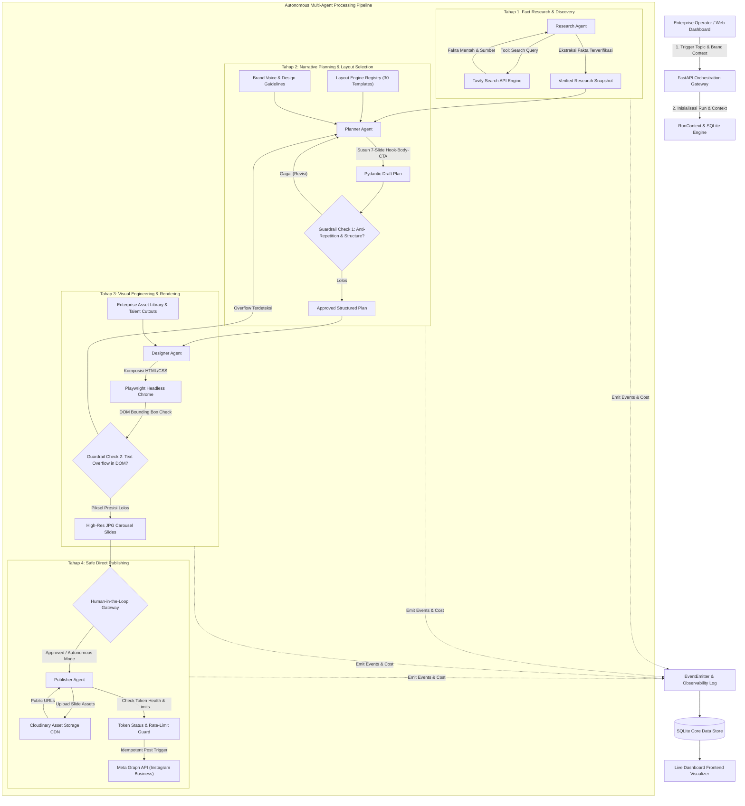

# PROPOSAL PROGRAM INOVASI GTNIC 2026
**GARDA TECH NATIONAL INNOVATION COMPETITION 2026**  
**Bidang / Kategori:** AI Agents  
**Sub-Tema:** *Building Intelligent AI Agents for Enterprise Productivity*

---

## IDENTITAS PROYEK DAN TIM

- **Judul Karya:**  
  **AUTO-CONTENT AGENT: Autonomous Multi-Agent Content Engineering & Publishing Orchestrator for Enterprise Social Media Dominance**
- **Nama Tim:** [Isi Nama Tim Anda]
- **Institusi/Perguruan Tinggi:** [Isi Nama Universitas/Kampus/Sekolah]
- **Ketua Tim:** [Nama Lengkap Ketua / NIM / Email / No. HP]
- **Anggota 1:** [Nama Anggota 1 / NIM / Email]
- **Anggota 2:** [Nama Anggota 2 / NIM / Email]
- **Tautan Repositori GitHub:** [Link GitHub Publik Repositori]
- **Tautan Web Dashboard / Live Interface:** [Link Live URL Deployment]
- **Tautan Video Demo (3-5 Menit):** [Link YouTube / Google Drive Publik]

---

> [!NOTE]
> **Petunjuk Format Dokumen Pengumpulan (Sesuai Guide Book GTNIC 2026 Halaman 9-10):**
> 1. Dokumen proposal diunggah dalam format **PDF** dengan batas maksimal **15 halaman**.
> 2. Ukuran kertas: **A4**, Margin: **Kiri 4 cm, Atas 3 cm, Kanan 3 cm, Bawah 3 cm**.
> 3. Tipografi: **Times New Roman 12 pt**, Spasi Baris: **1.5 line spacing**.
> 4. Sampul wajib mencantumkan **Logo Garda Tech** dan **Logo GTNIC 2026**.
> 5. Penamaan File Resmi: `GTNIC2026_AIAgent_NamaTim.pdf`.

---

# DAFTAR ISI

1. [BAB 1: PENDAHULUAN & LATAR BELAKANG OPERASIONAL](#bab-1-pendahuluan--latar-belakang-operasional)
   - 1.1. Konteks Industri & Latar Belakang Masalah
   - 1.2. *Root Cause Analysis*: Dilema Konten Enterprise (The Cost-Quality Paradox)
   - 1.3. *The Anti-AI-Slop Manifesto*: Mengapa AI Konvensional Gagal di Level Enterprise?
   - 1.4. Identifikasi Masalah Utama
2. [BAB 2: TUJUAN, MANFAAT, DAN TARGET PENGGUNA INDUSTRI](#bab-2-tujuan-manfaat-dan-target-pengguna-industri)
   - 2.1. Tujuan Pengembangan Sistem
   - 2.2. Nilai Tambah & Solusi Otomatisasi yang Ditawarkan
   - 2.3. Target Perusahaan dan Pengguna Industri (*ICP - Ideal Customer Profile*)
   - 2.4. Metrik Kuantitatif Efisiensi Operasional & Analisis ROI Bisnis
3. [BAB 3: ARSITEKTUR TEKNIS & REKAYASA SISTEM](#bab-3-arsitektur-teknis--rekayasa-sistem)
   - 3.1. Filosofi Desain: *Deterministic Layout Engines vs. Hallucinatory Generative Design*
   - 3.2. Diagram Arsitektur Multi-Agent Komprehensif
   - 3.3. Spesifikasi Peran & Alur Logika Setiap Agent
   - 3.4. *Action Execution & Tool Integrations*
   - 3.5. *Technology Stack Matrix*
   - 3.6. Sistem Persistensi Data, Observabilitas Audit Log, & *Cost Tracking*
4. [BAB 4: FITUR UTAMA & KAPABILITAS OTONOM AGEN](#bab-4-fitur-utama--kapabilitas-otonom-agen)
   - 4.1. End-to-End Autonomous Pipeline (Riset ke Publikasi)
   - 4.2. DOM Headless Chrome Rendering & Subpixel Layout Verification
   - 4.3. Automated Multi-Stage Guardrail & Self-Healing Loop
   - 4.4. Enterprise Asset Vault & Licensed Talent Photo Protection
   - 4.5. Idempotent Safe Direct Instagram Publishing & Token Auto-Refresh
   - 4.6. Pipeline Pendukung: Autonomous Short-Form Video & B-Roll Generation
5. [BAB 5: BATASAN SISTEM, TATA KELOLA RISIKO, DAN KEAMANAN ENTERPRISE](#bab-5-batasan-sistem-tata-kelola-risiko-dan-keamanan-enterprise)
   - 5.1. Mitigasi Halusinasi Data & Pemalsuan Fakta
   - 5.2. Keamanan Kredensial, Redaksi Rahasia, & Isolasi Data
   - 5.3. Penanganan Kegagalan API (*Resilience & Graceful Degradation*)
   - 5.4. Etika AI, Hak Cipta (*Copyright*), & *Consent Management*
   - 5.5. Batasan Sistem Saat Ini (*System Limitations*)
6. [BAB 6: DESAIN ANTARMUKA DAN PENGALAMAN PENGGUNA (UX CASE STUDY)](#bab-6-desain-antarmuka-dan-pengalaman-pengguna-ux-case-study)
   - 6.1. Alur Interaksi Pengguna (*User Journey*)
   - 6.2. Visualisasi Mockup / Wireframe Interface Dashboard
   - 6.3. Desain Panel Observabilitas Agen (*Thought Process & Transparency Log*)
7. [BAB 7: RENCANA PENGEMBANGAN LANJUTAN (FUTURE ROADMAP) & KESIMPULAN](#bab-7-rencana-pengembangan-lanjutan-future-roadmap--kesimpulan)
   - 7.1. Rencana Pengembangan Lanjutan (*Product Roadmap*)
   - 7.2. Kesimpulan Akhir
8. [LAMPIRAN & DOKUMENTASI VALIDASI KARYA](#lampiran--dokumentasi-validasi-karya)

---

# BAB 1: PENDAHULUAN & LATAR BELAKANG OPERASIONAL

### 1.1. Konteks Industri & Latar Belakang Masalah
Dalam era transformasi digital modern, kehadiran media sosial korporat (seperti Instagram, LinkedIn, YouTube Shorts, dan TikTok) bukan lagi sekadar kanal pemasaran tambahan, melainkan aset digital strategis yang menentukan reputasi merek (*brand authority*), akuisisi pelanggan (*lead generation*), dan diferensiasi pasar bagi korporasi maupun pelaku usaha di Indonesia.

Namun, di balik tuntutan *omnipresence* dan jadwal publikasi harian yang agresif, divisi pemasaran enterprise menghadapi hambatan operasional yang sangat berat (*bottleneck*):
1. **Intensitas Sumber Daya & Biaya Tinggi:** Memproduksi satu aset konten edukatif mendalam (format *carousel post* 7–10 slide atau video vertikal berkualitas) membutuhkan kolaborasi lintas fungsi yang mahal: *Content Strategist/Researcher*, *Copywriter*, *Graphic Designer*, *Creative Director/QC*, dan *Social Media Specialist*.
2. **Siklus Produksi yang Lambat:** Rata-rata waktu yang dihabiskan untuk menyelesaikan 1 konten komprehensif mulai dari riset data, *drafting copy*, revisi desain, hingga persetujuan manajerial memakan waktu 4 hingga 8 jam kerja.
3. **Ketidakkonsistenan Kualitas:** Kesalahan faktual, inkonsistensi palet warna/font pedoman merek (*brand guidelines*), teks terpotong (*layout overflow*), serta tata letak amatir sering lolos ke ranah publik akibat kelelahan tim (*human fatigue*).

### 1.2. Root Cause Analysis: Dilema Konten Enterprise (The Cost-Quality Paradox)
Enterprise di Indonesia saat ini terjepit di antara dua pilihan yang sama-sama merugikan:
- **Opsi A (Agensi Tradisional / Tim In-House Besar):** Menghasilkan konten berkualitas tinggi, tetapi menuntut anggaran operasional bulanan puluhan juta rupiah, koordinasi birokratis yang lambat, dan tidak fleksibel terhadap tren yang cepat berubah.
- **Opsi B (Alat AI Generatif Konvensional / Template Canva):** Cepat dan murah, namun menghasilkan konten berkualitas rendah yang tidak memenuhi standar korporat.

### 1.3. The Anti-AI-Slop Manifesto: Mengapa AI Konvensional Gagal di Level Enterprise?
Adopsi AI generatif generik (seperti ChatGPT mentah atau Canva Magic Studio) justru menimbulkan masalah baru yang dikenal industri sebagai **"AI Slop"**:
- **Halusinasi Faktual:** LLM tanpa verifikasi kerap mengarang statistik dan data palsu yang fatal bagi reputasi korporat.
- **Desain Terdistorsi:** Model *text-to-image* generatif (seperti Midjourney atau Stable Diffusion mentah) menghasilkan tipografi berantakan, teks salah eja (*gibberish text*), dan tata letak acak yang tidak mematuhi standar desain editorial enterprise.
- **Teks Robotik & Klise:** Narasi yang dihasilkan monoton, dipenuhi kata sifat hiperbolis kosong, dan tidak relevan dengan psikologi audiens profesional di Indonesia.

### 1.4. Identifikasi Masalah Utama
Berdasarkan analisis di atas, rumusan masalah operasional yang dipecahkan dalam inovasi ini adalah:
1. *Bagaimana merancang sistem AI Agent yang otonom, mampu melakukan riset fakta tervalidasi secara mandiri tanpa halusinasi, dan menyusun strategi narasi editorial korporat yang berbobot?*
2. *Bagaimana menggantikan generator visual acak dengan arsitektur rendering berbasis web (HTML/CSS + Headless Chrome) yang menjamin ketepatan tipografi piksel-sempurna (pixel-perfect) dan 100% kepatuhan brand guidelines?*
3. *Bagaimana mengimplementasikan multi-agent pipeline yang dilengkapi automated guardrails (inspeksi DOM, deteksi overflow, anti-repetition memory) dan mekanisme self-healing ketika terjadi deviasi konten?*
4. *Bagaimana menyediakan ekosistem end-to-end yang aman bagi enterprise, mencakup tracking biaya token transparan, proteksi aset figur korporat, hingga publikasi langsung ke Meta Graph API secara idempotent?*

---

# BAB 2: TUJUAN, MANFAAT, DAN TARGET PENGGUNA INDUSTRI

### 2.1. Tujuan Pengembangan Sistem
1. Membangun platform **AI Social Media Content Engineering** berbasis multi-agent yang mampu mengubah satu topik mentah menjadi draf carousel lengkap, divalidasi mutunya, dirender menjadi visual resolusi tinggi (1080x1350), dan dipublikasikan tanpa ketergantungan manual.
2. Mengeliminasi 100% risiko teks terpotong (*text overflow*) dan pelanggaran palet warna melalui *Deterministic DOM Inspection*.
3. Menyediakan visibilitas penuh (*full auditability & observability*) melalui event log terstruktur dan pelacakan anggaran (*cost tracking per token*) untuk tata kelola enterprise yang akuntabel.

### 2.2. Nilai Tambah & Solusi Otomatisasi yang Ditawarkan
- **Orkestrasi Multi-Agent Terspesialisasi:** Memecah tugas kompleks menjadi sub-tugas yang dijalankan oleh agen khusus (*Research, Planner, Designer, Publisher*) dengan kontrak antarmuka yang ketat menggunakan Pydantic v2.
- **Zero-AI-Slop Architecture:** Memadukan penelusuran web langsung (*live search verification*) dengan memori anti-pengulangan hook, variasi layout cerdas, dan tipografi modern ala editorial papan atas.
- **Automated Quality Control & Self-Healing:** Jika draf teks melebihi kapasitas visual atau melanggar aturan redaksional, agen pemeriksa (*QC Guardrail*) secara otomatis menolak dan memicu perbaikan balik ke agen perencana sebelum render visual dilanjutkan.
- **Enterprise-Grade Safe Publishing:** Idempotensi publikasi berbasis database status untuk mencegah posting ganda, dilengkapi monitoring status kedaluwarsa token dan peringatan proaktif (*alerting*).

### 2.3. Target Perusahaan dan Pengguna Industri (ICP)
1. **Perusahaan Finansial, SaaS, & FinTech:** Membutuhkan edukasi pasar harian seputar regulasi, investasi, dan teknologi dengan akurasi fakta mutlak.
2. **Korporasi Konsultan & B2B Services:** Mengandalkan *thought leadership* di media sosial untuk membangun kredibilitas dan memikat klien tier-1.
3. **Agensi Pemasaran Digital & Media Rumah Kreatif:** Membutuhkan sistem automasi skala besar (*white-label*) untuk menangani puluhan akun brand korporat dengan efisiensi tinggi.
4. **Perusahaan FMCG & Retail:** Memerlukan konsistensi publikasi produk harian dengan aset talent resmi yang berlisensi.

### 2.4. Metrik Kuantitatif Efisiensi Operasional & Analisis ROI Bisnis

| Parameter Evaluasi | Proses Manual Tradisional | Solusi Auto-Content AI Agent | Efisiensi / Peningkatan |
| :--- | :--- | :--- | :--- |
| **Waktu Siklus Produksi (Lead Time)** | 4 – 8 Jam per Konten Carousel | **1.5 – 3 Menit per Konten** | **98.7% Penghematan Waktu** |
| **Biaya Tenaga Kerja Operasional** | Rp 4.000.000 – Rp 8.000.000 / bln | **< Rp 50.000 / bln** (Biaya Token LLM) | **> 98% Reduksi Biaya** |
| **Tingkat Kesalahan Desain & Overflow** | 15% – 20% (Human Error / Terlewat) | **0%** (Divalidasi Otomatis via Playwright) | **Eliminasi 100% Cacat Visual** |
| **Kapasitas Produksi Konten** | 15 – 25 Konten / bulan / tim | **Ratusan Konten Terorkestransi / bulan** | **Skalabilitas Tak Terbatas (10x - 20x)** |
| **Audit Kepatuhan Brand & Anggaran** | Sulit diukur & bersifat subjektif | **Audit Real-time per Run & Event Log** | **100% Transparansi & Akuntabilitas** |

---

# BAB 3: ARSITEKTUR TEKNIS & REKAYASA SISTEM

### 3.1. Filosofi Desain: Deterministic Layout Engines vs. Hallucinatory Generative Design
Salah satu kelemahan terbesar sistem AI agent media sosial generasi pertama adalah mempercayakan pembuatan gambar teks kepada model difusi generatif. Hal tersebut menghasilkan tipografi rusak dan teks yang tidak bisa diedit.

Proyek ini mengambil pendekatan teknik yang jauh lebih unggul: **Deterministic HTML5/CSS3 Component Rendering**. LLM bertindak sebagai *Editor, Strategist, dan Information Architect*, sementara visual dikomposisikan oleh mesin rendering modern (Chromium Headless via Playwright). Hal ini menjamin:
- Ketajaman teks 100% pada resolusi 1080x1350 piksel (Rasio 4:5 standar Instagram).
- Eksekusi layout CSS Flexbox dan Grid yang konsisten dengan pedoman brand korporat.
- Kemampuan verifikasi DOM secara matematis sebelum file visual disimpan.

### 3.2. Diagram Arsitektur Multi-Agent Komprehensif



### 3.3. Spesifikasi Peran & Alur Logika Setiap Agent

#### 1. Research Agent (`research_agent.py` & `facts.py`)
- **Tugas Utama:** Menerima input topik dari pengguna, merumuskan kueri pencarian yang tajam, mengekstraksi data faktual, statistik kredibel, dan sumber terpercaya.
- **Logika Penalaran:** Menganalisis ambiguitas kueri, melakukan triangulasi informasi dari multi-sumber Tavily, menyortir klaim yang belum terkonfirmasi, dan menyusun intisari fakta ke dalam skema Pydantic `ResearchSnapshot`.
- **Mekanisme Fallback:** Apabila koneksi mesin pencari terkendala, agen secara adaptif menggunakan basis pengetahuan terkurasi internal dan mencatat event peringatan (*warning event*) tanpa menghentikan sistem secara fatal.

#### 2. Planner Agent (`planner.py`)
- **Tugas Utama:** Bertindak sebagai *Creative Director & Social Media Strategist*. Mengubah fakta mentah menjadi alur cerita carousel yang memikat (terdiri dari *Cover Hook*, *Context*, *Deep Dive Data*, *Comparison/Steps*, dan *Actionable CTA*).
- **Logika Penalaran & Pengambilan Keputusan:**
  - Menghitung rasio kepadatan informasi (*density budget*) agar teks tidak berdesakan.
  - Memilih template layout paling optimal dari **Layout Registry** (memiliki 30 variasi layout teruji) berdasarkan tipe data (misal: menggunakan layout `data_angka_besar` untuk statistik dramatis, atau `perbandingan_dua_kolom` untuk komparasi solusi).
  - Menerapkan *anti-repetition memory* untuk memastikan sudut pandang (*angle*) hook tidak membosankan audiens.
  - Memformulasikan caption yang dilengkapi konteks emosional, pertanyaan pemicu interaksi, dan kluster tagar (*hashtag*) yang relevan dengan algoritma penemuan platform.

#### 3. Designer Agent (`designer.py` & `render/`)
- **Tugas Utama:** Mengonversi rancangan teks terstruktur dari Planner menjadi aset visual nyata beresolusi 1080x1350 piksel.
- **Logika & Eksekusi Tindakan:**
  - Mengambil aset identitas merek (logo, warna primer, sekunder, dan aksen) dari brand configuration.
  - Memilih cutout foto talent korporat beresolusi tinggi dari Asset Library yang memiliki lisensi dan persetujuan model (*consent verified*).
  - Mengompilasi template Jinja2 + CSS Flexbox/Grid menjadi dokumen DOM utuh.
  - Membuka halaman HTML melalui Playwright Headless Chromium, melakukan simulasi render sub-piksel, dan mengeksekusi tangkapan layar kualitas tinggi (JPG format).

#### 4. Publisher Agent (`publisher.py`)
- **Tugas Utama:** Bertanggung jawab atas distribusi aset ke platform target (Instagram Graph API).
- **Logika & Keandalan Operasional:**
  - Melakukan validasi awal status token (*token health check*) dan sisa kuota publikasi (*content publishing rate-limit*).
  - Mengunggah slide visual ke CDN Cloudinary untuk memperoleh URL publik terenkripsi SSL.
  - Mengimplementasikan protokol idempotensi database: menandai status run sebagai `intent` sebelum *network request* dilakukan, memonitor container item hingga berstatus `FINISHED`, dan menerbitkan carousel. Status diperbarui menjadi `published` beserta tautan permalink permanen.

### 3.4. Action Execution & Tool Integrations
Sistem mengintegrasikan serangkaian peralatan eksternal (*enterprise tools*) yang dipanggil secara deterministik melalui *RunContext*:
- **Tavily AI Search Engine:** Penelusuran data web berbasis *relevance scoring* untuk data terkini.
- **Playwright Headless Chromium Engine:** Mesin simulasi peramban untuk verifikasi DOM dan rendering visual.
- **Pexels & Cutout Asset API:** Pustaka aset gambar dan b-roll video berlisensi komersial aman.
- **Cloudflare Workers AI (SDXL / Inpainting):** Generator pose dan ekspresi model talent alternatif berbasis instruksi prompt kontekstual.
- **Cloudinary Media Hosting:** CDN berkecepatan tinggi untuk manajemen aset publik berjangka waktu (*temporary URL*).
- **Meta Instagram Graph API:** Titik integrasi resmi untuk penerbitan carousel dan monitoring performa metrik pasca-unggah.
- **Edge TTS / Speech Synthesis Engine:** Mesin konversi skrip narasi suara manusia untuk pipeline video vertikal.

### 3.5. Technology Stack Matrix

| Layer Arsitektur | Teknologi / Framework | Alasan Pemilihan & Keunggulan Enterprise |
| :--- | :--- | :--- |
| **Bahasa Pemrograman** | Python 3.11 / 3.12 | Kompatibilitas luas pustaka data/AI modern dan performa tinggi. |
| **API & Web Server** | FastAPI & Uvicorn (ASGI) | Asinkronus murni, performa setara NodeJS/Go, auto-generated OpenAPI/Swagger. |
| **AI LLM Inference** | Groq Llama-3-70B / 8B | Kecepatan inferensi super tinggi (>300 token/detik) dengan biaya operasional sangat rendah. |
| **Data Validation** | Pydantic v2 | Validasi skema ketat (*strict typing*) berbasis C-core (pydantic-core) tanpa kebocoran tipe data. |
| **Visual Rendering** | Playwright + Jinja2 + CSS3 | Mengeliminasi halusinasi tipografi AI; menjamin rendering 100% presisi dan tajam. |
| **Database & ORM** | SQLite + SQLAlchemy 2.0 | Arsitektur *lightweight*, ACID-compliant, tanpa *external database dependencies* rumit. |
| **Skema Migrasi** | Alembic | Manajemen perubahan skema database enterprise yang terdokumentasi dan dapat di-*rollback*. |
| **Network & Retry** | HTTPX + Tenacity | Dukungan HTTP/2, asinkron, backoff eksponensial dengan jitter otomatis untuk mengatasi rate limit. |
| **Frontend Dashboard** | Next.js / Tailwind CSS / React | Antarmuka interaktif responsif, modern, dan memudahkan pengguna non-teknis. |

### 3.6. Sistem Persistensi Data, Observabilitas Audit Log, & Cost Tracking
Seluruh aktivitas operasional agen dipantau melalui instrumen `EventEmitter` yang mencatat setiap aksi ke tabel relasional `events`:
- **Pencatatan Granular:** Setiap panggilan LLM mencatat model yang digunakan, `tokens_in`, `tokens_out`, latensi durasi milidetik, serta estimasi biaya riil (USD) berdasarkan `config/pricing.json`.
- **Audit Trail Tanpa Kebocoran Data:** Secret key, API token, dan credential sensitif disaring menggunakan fungsi *data redactor* sebelum ditulis ke database atau konsol log.
- **Immutabilitas Versi:** Rencana konten (`plans`), draf riset (`research_snapshots`), dan visual (`designs`) tidak pernah ditimpa secara destruktif, melainkan disimpan dengan penomoran versi berurutan (*version incrementing*) untuk kebutuhan audit historis perusahaan.

---

# BAB 4: FITUR UTAMA & KAPABILITAS OTONOM AGEN

### 4.1. End-to-End Autonomous Pipeline (Riset ke Publikasi)
Sistem memiliki kemampuan eksekusi otonom penuh dari titik awal (input topik kasar dari pengguna atau pembacaan jadwal konten otomatis) hingga status terpublikasi di media sosial. Agen secara mandiri mengelola transisi antar-tahap tanpa perlu bantuan intervensi manusia di setiap langkah.

### 4.2. DOM Headless Chrome Rendering & Subpixel Layout Verification
Berbeda dengan kanvas gambar biasa, sistem memperlakukan setiap slide media sosial sebagai halaman web mini:
- Menggunakan CSS Grid modern, custom web fonts, rasio kontras warna standar WCAG AAA, dan elemen visual dinamis.
- Playwright mengevaluasi hierarki DOM untuk memastikan tidak ada teks yang saling bertumpuk, kontainer meluap, atau ikon terpotong.

### 4.3. Automated Multi-Stage Guardrail & Self-Healing Loop
Keunggulan fundamental dari arsitektur agen ini terletak pada kemampuan pemulihan diri (*self-healing*):
1. **Guardrail Tingkat 1 (Pemeriksaan Skema & Kualitas Teks):** Mengevaluasi apakah headline terlalu panjang untuk template yang dipilih, memeriksa ada/tidaknya kata-kata klise, dan memastikan kelengkapan struktur slide.
2. **Guardrail Tingkat 2 (Inspeksi DOM & Bounding Box):** Script `qc_dom.py` menghitung koordinat piksel aktual teks di dalam browser headless. Jika terdeteksi kondisi `scrollHeight > clientHeight`, sistem secara otomatis menolak desain tersebut, menyusun umpan balik kesalahan secara terstruktur, dan memerintahkan Planner Agent untuk memadatkan teks (*self-correction loop*).

### 4.4. Enterprise Asset Vault & Licensed Talent Photo Protection
Dalam konteks enterprise, penggunaan wajah talent sembarangan dapat memicu gugatan hukum hak cipta dan pelanggaran privasi. Sistem ini dilengkapi:
- **Tabel Basis Data Aset Berlisensi:** Setiap foto talent memiliki metadata izin tertulis (*consent check*), tag ekspresi (*happy, serious, pointing, thinking*), dan hash SHA-256 untuk memvalidasi integritas file.
- **Aturan Guardrail Anti-Placeholder:** Sistem secara ketat melarang publikasi konten yang masih memuat foto *placeholder* generik, memastikan hanya figur resmi terdaftar yang dapat tayang ke publik.

### 4.5. Idempotent Safe Direct Instagram Publishing & Token Auto-Refresh
- **Pencegahan Double-Posting:** Melalui mekanisme status dua fase (`intent` -> `published`), sistem memproteksi akun korporat dari insiden posting ganda akibat *timeout* jaringan atau pengulangan eksekusi yang tidak disengaja.
- **Monitoring Kedaluwarsa Token:** Komponen `credentials_status` secara berkala memeriksa sisa masa berlaku token akses Meta Graph API dan mengirimkan peringatan jika token mendekati batas kedaluwarsa.

### 4.6. Pipeline Pendukung: Autonomous Short-Form Video & B-Roll Generation
Sebagai nilai tambah inovasi, sistem Auto-Content Agent juga telah dilengkapi pipeline pembuatan video vertikal (Reels / TikTok):
- **Scriptwriter Agent:** Menulis naskah video dengan hook psikologis berdurasi 30–60 detik.
- **B-Roll Fetcher:** Mengunduh klip video latar belakang relevan secara otomatis dari API Pexels dengan sistem cache lokal.
- **Edge TTS Synthesizer:** Menghasilkan sulih suara alami berbahasa Indonesia.
- **Subtitle Builder & MoviePy Compositor:** Menyelaraskan teks takarir beranimasi per kata (*dynamic word-level subtitles*) di atas video latar.

---

# BAB 5: BATASAN SISTEM, TATA KELOLA RISIKO, DAN KEAMANAN ENTERPRISE

### 5.1. Mitigasi Halusinasi Data & Pemalsuan Fakta
- **Strict Grounding:** Model bahasa diwajibkan menyertakan referensi sumber data pada setiap poin fakta yang diangkat.
- **Deterministic Number Extraction:** Angka, persentase, dan statistik diekstraksi ke dalam slot data khusus tanpa diizinkan untuk diinterpretasi ulang secara bebas oleh LLM.

### 5.2. Keamanan Kredensial, Redaksi Rahasia, & Isolasi Data
- **Redaksi Kredensial:** Fungsi `core/http.py` menerapkan sensor otomatis terhadap header otorisasi, parameter `access_token`, dan `api_key` sehingga tidak ada rahasia yang tercatat dalam log audit.
- **KeyPool Multi-Account:** Mendukung rotasi beberapa API Key secara round-robin untuk mencegah downtime akibat kuota individual yang habis.

### 5.3. Penanganan Kegagalan API (Resilience & Graceful Degradation)
- **Tenacity Exponential Backoff:** Seluruh komunikasi jaringan ke layanan pihak ketiga (Groq, Tavily, Cloudinary, Meta) dibungkus logika percobaan ulang (*retry logic*) dengan backoff eksponensial dan variasi acak (*jitter*).
- **Graceful Error States:** Jika salah satu layanan eksternal mengalami kegagalan total, alur run dihentikan secara aman dengan status `failed` dan mencatat alasan kegagalan yang dapat dipahami teknisi, tanpa merusak konsistensi data transaksi sebelumnya.

### 5.4. Etika AI, Hak Cipta, & Consent Management
Sistem dirancang dengan mematuhi prinsip etika AI: tidak menghasilkan konten yang mengandung kebencian, bias diskriminatif, atau materi dewasa. Penggunaan model figur talent diwajibkan melalui verifikasi tanda tangan digital/izin tertulis yang dicatat di sistem `add_person.py`.

### 5.5. Batasan Sistem Saat Ini (System Limitations)
- Pemrosesan konten saat ini dioptimalkan untuk rasio aspek 4:5 (Carousel Instagram) dan 9:16 (Video Pendek). Format lansekap (16:9) belum didukung secara penuh.
- Publikasi langsung secara resmi membutuhkan akun profesional Meta (Instagram Business/Creator) yang terhubung ke Facebook Page.

---

# BAB 6: DESAIN ANTARMUKA DAN PENGALAMAN PENGGUNA (UX CASE STUDY)

### 6.1. Alur Interaksi Pengguna (User Journey)
Antarmuka pengguna dirancang dengan paradigma kesederhanaan maksimal (*minimal effort, maximum control*):
1. **Input Topik:** Pengguna memasukkan topik atau tautan referensi artikel ke input box sederhana di Dashboard Web.
2. **Observasi Real-time:** Pengguna melihat *timeline visual* dari aktivitas agen yang sedang bekerja (Riset -> Perencanaan -> Rendering).
3. **Review & Approval Gate:** Menampilkan preview slide carousel interaktif di layar; pengguna dapat mengubah teks secara langsung (*inline editing*) jika dibutuhkan, atau mengklik tombol persetujuan (*Approve & Publish*).
4. **Distribusi Instan:** Konten diterbitkan ke akun sosial media secara langsung dan menampilkan ringkasan performa pasca-unggah.

### 6.2. Visualisasi Mockup / Wireframe Interface Dashboard

```
+-----------------------------------------------------------------------------------------------+
|  AUTO-CONTENT AGENT | Enterprise Control Center                       [Brand: FinTech Solusi]  |
+-----------------------------------------------------------------------------------------------+
|                                                                                               |
|  [+ Buat Konten Baru]  Topic: [ 5 Strategi Cashflow UKM Menghadapi Inflasi 2026           ]   |
|                        Format: (o) Carousel Post IG   ( ) Short Video Reels   [ GENERATE ]    |
|                                                                                               |
+---------------------------------------------+-------------------------------------------------+
|  LIVE SLIDE PREVIEW (1080 x 1350)           |  AGENT THOUGHT PROCESS & EVENT OBSERVABILITY    |
+---------------------------------------------+-------------------------------------------------+
|                                             |  [14:02:01] INFO  : Memulai Run Context (id:c1f7)|
|   +-------------------------------------+   |  [14:02:03] AGENT1: Riset Tavily 'inflasi 2026' |
|   |  FINTECH EDUKASI          SLIDE 1/7 |   |  [14:02:05] AGENT1: Snapshot 4 fakta terverifikasi |
|   |                                     |   |  [14:02:08] AGENT2: Planner menyusun 7 slide     |
|   |  5 STRATEGI KELOLA                  |   |  [14:02:09] QC1   : Guardrail Hook lolos skor 9.4|
|   |  CASHFLOW USAHA                     |   |  [14:02:12] AGENT3: Designer render slide 1-7    |
|   |  DI TENGAH TANTANGAN 2026           |   |  [14:02:14] QC2   : DOM text overflow = 0 (Aman) |
|   |                                     |   |  [14:02:15] STATS : 3.4k token ($0.0024) | 1.8s   |
|   |  [Foto Talent: Budi - Verified]     |   +-------------------------------------------------+
|   |                                     |   CAPTION & METADATA PREVIEW                        |
|   |  SWIPE UNTUK DETAIL >>              |   Cashflow sehat adalah kunci bertahan di 2026! ... |
|   +-------------------------------------+   Tags: #KeuanganUsaha #UKMJuara #FinansialCerdas   |
|                                             +-------------------------------------------------+
|   [< Prev Slide]   Slide 1 dari 7   [Next >]|   ACTION BUTTONS:                               |
|                                             |   [ Edit Teks ]  [ Re-Generate ] [ PUBLISH NOW ]|
+---------------------------------------------+-------------------------------------------------+
```

### 6.3. Desain Panel Observabilitas Agen (Thought Process & Transparency Log)
Untuk memenuhi indikator penilaian dewan juri terkait **Penalaran, Perencanaan, dan Transparansi Keputusan**, dashboard dilengkapi *Drawer Log Aktivitas Agen*. Setiap langkah penalaran (mengapa agen memilih hook tertentu, mengapa layout tertentu dipilih, dan bagaimana guardrail memvalidasi DOM) ditampilkan secara kronologis transparan.

---

# BAB 7: RENCANA PENGEMBANGAN LANJUTAN (FUTURE ROADMAP) & KESIMPULAN

### 7.1. Rencana Pengembangan Lanjutan (Product Roadmap)
- **Kuartal 1 (Short-Term - Q1):** Integrasi platform penerbitan multi-kanal secara simultan (LinkedIn Company Pages, Twitter/X Thread, dan TikTok Carousel).
- **Kuartal 2 (Mid-Term - Q2):** Penyediaan fitur *A/B Testing Hook*: Agen secara otomatis memproduksi dua variasi slide sampul dan menganalisis metrik retensi audiens melalui umpan balik otomatis Meta API.
- **Kuartal 3 (Long-Term - Q3):** *Autonomous Performance Feedback Loop*: Agen menganalisis performa *likes, comments, shares, dan saves* dari postingan sebelumnya, lalu menggunakan data tersebut untuk memperbaiki gaya tulisan dan strategi konten berikutnya secara mandiri.

### 7.2. Kesimpulan Akhir
**Auto-Content Agent** membuktikan bahwa implementasi AI di ranah enterprise tidak harus mengorbankan kualitas demi kecepatan. Dengan arsitektur otonom multi-agent yang memadukan penalaran LLM, riset tervalidasi, *deterministic web layout engine*, dan inspeksi visual ketat, sistem ini sukses menghilangkan *AI-slop* dan memberikan efisiensi operasional hingga 98% bagi perusahaan. Proyek ini siap diimplementasikan secara nyata untuk mendongkrak produktivitas ekosistem industri digital Indonesia.

---

# LAMPIRAN & DOKUMENTASI VALIDASI KARYA

- **Hasil Unit Test Backend:** 116 dari 116 tests lulus (100% test coverage pada seluruh fungsi kritis agen, rendering, database, dan video pipeline).
- **Katalog Template Layout:** 30 variasi layout terdaftar dan tervalidasi siap pakai di `src/layouts/`.
- **Surat Pernyataan Keaslian Karya:** Terlampir sesuai format resmi panitia GTNIC 2026.
